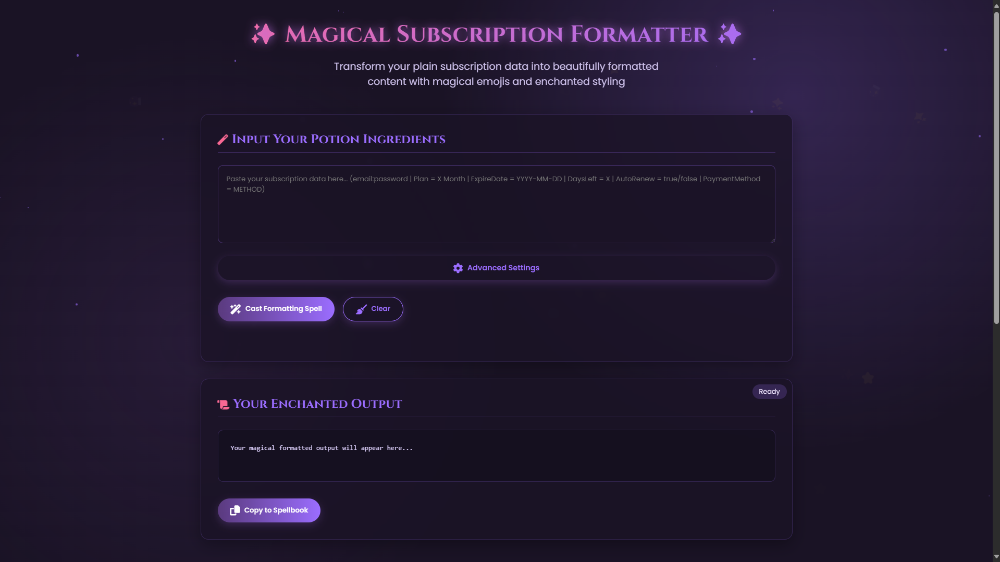

# ✨ Arcane Subscription Formatter ✨

An enchanted utility that transmutes chaotic, raw subscription data into beautifully formatted, easy-to-read scrolls. This powerful formatter is designed to intelligently parse a wide variety of input formats, identify numerous data fields, and present subscription information with thematic emojis and an arcane aesthetic.

## 🔮 Quick Links

- **[Launch the Arcane Formatter](https://darkphoenixir.github.io/Fantasy-Subscription-Formatter/Magical-Subscription-Formatter.html)** - Open the application directly from GitHub Pages.
- [View the Source Code](./Magical-Subscription-Formatter.html) - Delve into the complete HTML, CSS, and JavaScript.

   *(Consider updating your screenshot here if the UI has changed significantly, or add a new one showing the more complex data handling.)*
    <!-- Update if needed -->

## 🌟 Features

-   **Immersive Arcane UI:** A rich, fantasy-themed interface complete with captivating animations, particle effects, and a mystical portal.
-   **Intelligent Line-by-Line Parsing:** Robustly processes each line of input, extracting credentials and detailed key-value data.
-   **Advanced Field Recognition:** Dynamically identifies a wide array of fields including email, password, plan details, expiration dates, payment information, country, provider, and much more.
-   **Dynamic & Thematic Formatting:** Automatically applies appropriate emojis and styling to each recognized field for clarity and visual appeal.
-   **Customizable Password Cleaning:** Removes unwanted tags or artifacts from passwords using default and user-defined regex patterns.
-   **Line Artifact Removal:** Cleans up common line-level noise (e.g., `@Username` tags) before parsing.
-   **Error Resilience:** Gracefully handles malformed or inconsistent inputs with error recovery and aggressive parsing options.
-   **Copy to Grimoire:** One-click copying of the transmuted output.
-   **Responsive Design:** Adapts seamlessly to desktops, tablets, and mobile devices.
-   **Advanced Glyphs Settings:** Fine-tune parsing behavior with options for aggressive parsing, multi-strategy (future), deep field inspection, error recovery, and artifact removal.
-   **Dynamic Legend:** The "Lexicon of Arcane Symbols" updates based on the fields and emojis used by the formatter.

## 🧙‍♂️ How It Works

1.  Paste your raw subscription glyphs (data) into the "Input Raw Glyphs" cauldron.
2.  Adjust "Advanced Glyphs Settings" if needed, including custom password tag removal patterns.
3.  Click the "Transmute Data" button.
4.  Behold as your chaotic data is alchemically transformed into an "Enchanted Scroll" of neatly formatted information.
5.  Copy the result to your digital "Grimoire" (clipboard) with a single click.

## 📋 Input Format Examples

The formatter is designed to handle data where each line typically represents an account:

**Primary Expected Format:**
`email@example.com:YourPassword123 | Plan = Premium Yearly | ExpireDate = 2025-12-31 | Country = US | AutoRenew = true`

**It can also handle variations like:**
`user@domain.net:SecretPass | ProductName = VPN Basic | Next Renewal Date = January 5, 2026 | Provider = Nord`
`another@email.org:Pass!@# | IsFreeTrial = false | Purchase Date = 2023-01-01 | PaymentMethod = PayPal | @SomeTagToRemove`

The parser intelligently extracts the `email:password` pair and then processes the remaining part of the line as `Key = Value` pairs separated by `|`. Values enclosed in `[square brackets]` will have the brackets removed.

## 🎨 Formatting & Emojis (Examples)

The formatter uses a rich set of emojis. Here are a few common ones:

-   📧 **Email:** `email@example.com`
-   🔑 **Password:** `` `YourPassword123` `` (in monospace)
-   📜 **Plan:** `Premium Yearly`
-   ⏳ **Expire Date:** `2025-12-31`
-   🛍️ **Purchase Date:** `2024-01-15`
-   ⏱️ **Days Left:** `365` (if present)
-   🔄 **Auto Renew:** `✅ Yes` / `❌ No` (only if explicitly found)
-   💳 **Payment Method:** `Credit Card`
-   🌍 **Country:** `US`
-   ⚙️ **Provider:** `Netflix`
-   ... and many more! (See the dynamic "Lexicon of Arcane Symbols" in the app)

## ⚙️ Advanced Glyphs Settings

Tailor the transmutation process with these powerful options:

-   **Aggressive Parsing:** Employs more lenient rules to extract data from highly irregular inputs.
-   **Multi-Strategy:** (Placeholder for future enhancements with diverse parsing engines).
-   **Deep Field Inspection:** More thoroughly attempts to normalize and identify various field names.
-   **Error Recovery:** Tries to salvage partial data even if full parsing of a line fails.
-   **Remove Password Tags:** Enables cleaning of passwords using the defined regex patterns.
-   **Remove Line Artifacts:** Strips common non-data tags (e.g., `@Username`) from lines before parsing.
-   **Password Tag Removal Patterns:** Add custom regular expressions to cleanse specific tags or text from passwords.

## 🚀 Usage

Simply open the [Magical-Subscription-Formatter.html](https://darkphoenixir.github.io/Fantasy-Subscription-Formatter/Magical-Subscription-Formatter.html) file in any modern web browser. No server setup or installation is required!

## 💻 Technical Details

This arcane instrument is forged with:

-   HTML5
-   CSS3 (featuring intricate animations, transitions, and visual effects)
-   Vanilla JavaScript (ES6+ features, no external libraries for core functionality beyond FontAwesome)

The `UltraFormatter` engine employs:

-   **Line-by-Line Processing:** Each line is treated as a potential account.
-   **Regex-Powered Extraction:** Sophisticated regular expressions for `email:password` and key-value pair separation.
-   **Dynamic Field Normalization:** Maps a wide variety of raw key names to standardized internal field names.
-   **Value Sanitization:** Handles boolean conversion and removes surrounding brackets from values.
-   **Configurable Artifact Removal:** User-defined patterns for password cleaning.
-   **Structured Output Generation:** Orders fields logically and applies thematic emojis.

## 📜 License

This project is licensed under the MIT License. Feel free to conjure, modify, and distribute this code!

## 🧙‍♂️ Created By

Forged in the digital ether by [Darkphoenixir](https://github.com/Darkphoenixir) - The Fallen Angel.

---

*This project was transmuted with ✨ arcane energies ✨ and a dash of ✨ ethereal code ✨*
